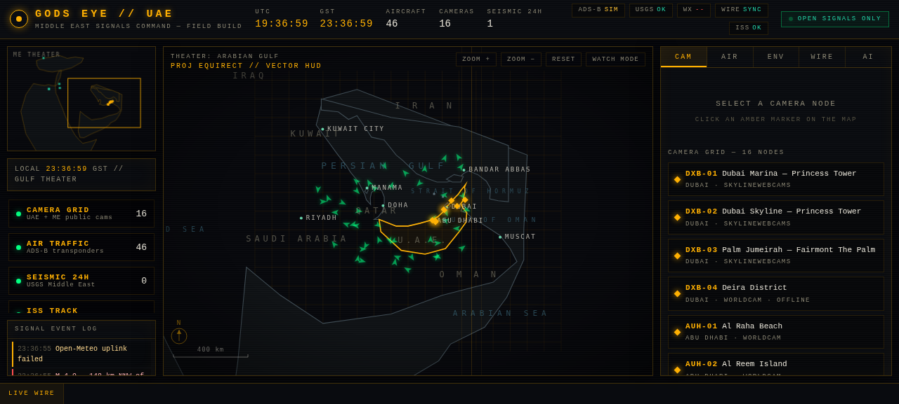
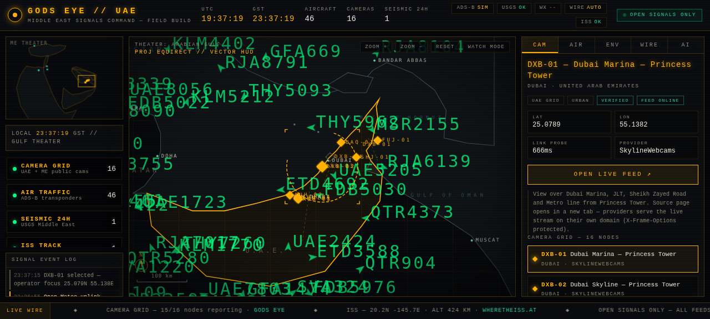
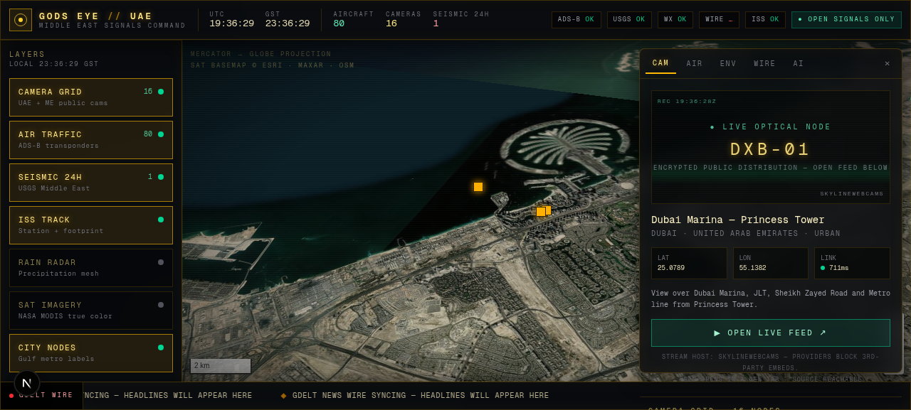
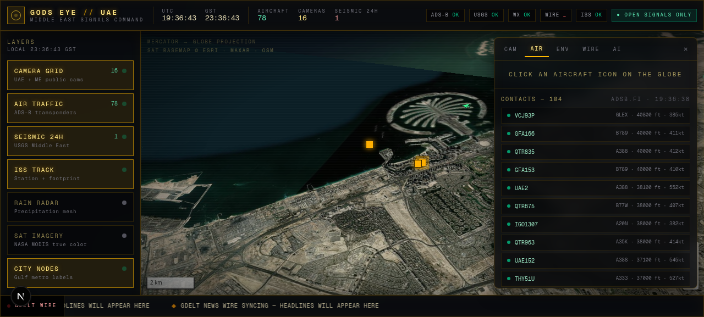

<div align="center">

# 🔶 GODS EYE // UAE

### Middle East Signals Command — open-signals mission console, UAE first

[](https://github.com/YOUR_USERNAME/gods-eye-uae/actions/workflows/pages.yml)
[](LICENSE)
[](#-field-build--one-file--zero-dependencies)
[](#-command-center--nextjs-16-edition)

**A mission-control HUD for the Middle East's open signals — live camera grid, ADS-B air
traffic, seismic events, ISS telemetry and weather wire, with the United Arab Emirates
as the operational centerpiece.**

</div>

---



> The **FIELD BUILD** vector theater: Arabian Gulf at a glance — amber UAE camera sector,
> green ADS-B contacts, graticule, scale bar, compass and the ME THEATER minimap.

## What is this?

GODS EYE // UAE is a **monitoring console for publicly available open signals** across the
Middle East, designed around a dark mission-control aesthetic (amber / emerald on near-black,
monospace HUD typography, CRT scanline texture). It ships in two editions:

| | 🛰 FIELD BUILD | 🌍 COMMAND CENTER |
|---|---|---|
| **File** | `index.html` — one single file | `command-center/` — full Next.js 16 app |
| **Stack** | Vanilla JS + Canvas 2D | React + MapLibre GL globe + AI analyst |
| **Dependencies** | **Zero.** No build step, no framework | Node/bun + npm/bun install |
| **Hosting** | GitHub Pages, any static host, or `file://` | Any Node server (or your own VPS) |
| **Map** | Hand-built Canvas 2D vector theater | Esri World Imagery satellite globe |
| **AI analyst** | On-device heuristic brief | LLM-powered situation brief (`/api/analyst`) |
| **Best for** | Instant launch, sharing, embedding | The full cinematic experience |

Both editions track the same mission picture: a **29-node Middle East camera grid with the
UAE at the center**, live aircraft over the Gulf, seismic events from USGS, ISS passes,
regional weather, and a news wire — every feed public, every data source attributed on-screen.

## ⚡ Launch on GitHub Pages (60 seconds)

This repository is **launch-ready**. Everything GitHub needs is already inside:
the site itself, a `LICENSE`, a `.gitignore`, and a preconfigured
`.github/workflows/pages.yml` that builds and deploys the site on every push to `main`.

1. **Create a new repository** on GitHub (e.g. `gods-eye-uae`), then push this folder:

   ```bash
   cd gods-eye-uae
   git init -b main                     # already done if you kept the .git folder
   git add -A
   git commit -m "GODS EYE // UAE — initial release"
   git remote add origin https://github.com/YOUR_USERNAME/gods-eye-uae.git
   git push -u origin main
   ```

2. **Enable Pages**: repository **Settings → Pages → Build and deployment →
   Source: GitHub Actions**. (No other settings required — the included workflow
   handles the rest.)

3. **Done.** Within a minute your console is live at:

   ```
   https://YOUR_USERNAME.github.io/gods-eye-uae/
   ```

> Prefer zero-configuration instead of Actions? Set **Settings → Pages → Source:
> Deploy from a branch → `main` / `(root)`** — GitHub will serve `index.html` directly.
> In that case you can delete `.github/workflows/pages.yml`.

## 🛰 Field Build — one file, zero dependencies



Open `index.html` in any browser — from disk, USB stick, or a static host — and the
console boots straight into the Arabian Gulf theater. No install, no API keys, no build.

- **Vector theater map** — hand-simplified WGS84 coastlines (Arabia incl. Qatar and the
  Musandam enclave, Iran, Qeshm, Bahrain), amber UAE sector with approximate emirate
  borders, graticule, scale bar and compass
- **29-node camera grid** — click a node for a dashed selection reticle, cinematic zoom,
  coordinate/LINK-probe detail panel and an **OPEN LIVE FEED** button to the provider page
- **13 nodes stream embedded in-page** — DXB-05…10 (six 24/7 Dubai feeds: Burj Khalifa,
  Dubai Marina ×2, JBR The Walk, City Center day + night), MKKA-01/02 (Makkah Masjid al-Haram
  + Kaaba HD), MDNA-01/02 (Madinah Masjid an-Nabawi ×2), JRS-02/03 (Jerusalem Western Wall
  via EarthCam + official Kotel Cams) and OSINT-01 (rotating Middle East multi-cam OSINT
  grid) play right inside the console via the sources' official YouTube players
- **Live ADS-B layer** — aircraft symbols with callsign labels, honestly tagged
  `LIVE` or `SIM` depending on feed reachability from your network
- **Signal event log + LIVE WIRE ticker** — camera health flicker, quakes, ISS telemetry,
  weather wire entries streaming in real time
- **Tabs** — `CAM` camera grid · `AIR` air contacts · `ENV` weather/seismic/ISS ·
  `WIRE` headlines · `AI` situation brief
- **WATCH MODE** — auto-hops between UAE cameras every 12 s with cinematic focus
- **Pan / zoom / fly-to**, ME THEATER minimap with live viewport rectangle,
  boot sequence, scanline overlay

Run it locally (or just double-click it):

```bash
python3 -m http.server 8080   # then open http://localhost:8080
# …or simply open index.html directly — file:// works too
```

## 🌍 Command Center — Next.js 16 edition



The full cinematic build: a **MapLibre GL satellite globe** (Esri World Imagery) over the
Gulf, layer rail with live counters, GDELT news ticker and an **AI analyst** that generates
situation briefs from the live feeds.

```bash
cd command-center
bun install            # or: npm install
cp .env.example .env.local
bun run db:push        # materialize the local SQLite scaffold (or: npx prisma db push)
bun run dev            # or: npm run dev  →  http://localhost:3000
```

- `/` — the mission console (boot sequence, HUD top bar, globe, layer rail, context panel)
- `/api/aircraft` · `/api/quakes` · `/api/weather` · `/api/iss` · `/api/news` ·
  `/api/radar` · `/api/cameras/health` — TTL-cached proxy routes for the public feeds
  (keeps your browser off third-party rate limits)
- `/api/analyst` — LLM situation brief with live context injection
  (set `ZAI_API_KEY` or your provider key in the environment to enable)



## 📷 Camera grid — 20 verified public nodes

| ID | Location | City | Provider |
|---|---|---|---|
| DXB-01 | Dubai Marina — Princess Tower | Dubai | SkylineWebcams |
| DXB-02 | Dubai Skyline — Princess Tower | Dubai | SkylineWebcams |
| DXB-03 | Palm Jumeirah — Fairmont The Palm | Dubai | SkylineWebcams |
| DXB-04 | Deira District | Dubai | WorldCam |
| AUH-01 | Al Raha Beach | Abu Dhabi | WorldCam |
| AUH-02 | Al Reem Island | Abu Dhabi | WorldCam |
| AUH-03 | Masdar City | Abu Dhabi | WorldCam |
| AUH-04 | Yas Bay | Abu Dhabi | WorldCam |
| SHJ-01 | Al Dhaid — Sharjah Safari Reserve | Sharjah | WorldCam |
| FUJ-01 | Dibba — Sandy Beach | Fujairah | WorldCam |
| UAQ-01 | Kite Beach Center | Umm Al Quwain | WorldCam |
| CAI-01 | Giza — Great Pyramid & Khafre | Cairo | SkylineWebcams |
| CAI-02 | Giza — Pyramids & Sphinx | Cairo | SkylineWebcams |
| IST-01 | Istanbul — Golden Horn | Istanbul | SkylineWebcams |
| JRS-01 | Jerusalem — Old City Overview | Jerusalem | SkylineWebcams |
| PTRA-01 | Petra — Rose City Approach | Ma'an Governorate | SkylineWebcams |
| DXB-05 | Dubai 24/7 — Burj Khalifa Skyline ▶ | Dubai | UinDubai · YouTube |
| DXB-06 | Dubai Marina 24/7 — Marina Walk ▶ | Dubai | UinDubai · YouTube |
| DXB-07 | Dubai Marina 24/7 — CitiesTouch Feed ▶ | Dubai | CitiesTouch · YouTube |
| DXB-08 | JBR The Walk 24/7 — Beachfront ▶ | Dubai | UinDubai · YouTube |
| DXB-09 | City Center 24/7 — Downtown Panorama ▶ | Dubai | UinDubai · YouTube |
| DXB-10 | Night City Center 24/7 — Burj Skyline ▶ | Dubai | UinDubai · YouTube |
| MKKA-01 | Makkah — Masjid al-Haram ▶ | Makkah | Saudi Quran TV (official) · YouTube |
| MKKA-02 | Makkah — Kaaba HD 24/7 ▶ | Makkah | Ar Rahman · YouTube |
| MDNA-01 | Madinah — Masjid an-Nabawi ▶ | Madinah | Saudi Sunnah TV (official) · YouTube |
| MDNA-02 | Madinah — Nabawi Mosque 24/7 ▶ | Madinah | Noor Al-Haram · YouTube |
| JRS-02 | Jerusalem — Western Wall (Kotel) ▶ | Jerusalem | EarthCam · YouTube |
| JRS-03 | Jerusalem — Western Wall Main Plaza ▶ | Jerusalem | Kotel Cams (official) · YouTube |
| OSINT-01 | Middle East Multi-Feed — OSINT Grid ▶ | Regional | InquizeX · YouTube |

▶ = official stream **embedded in-page** (watch it directly inside the console).

Camera hosts block third-party embedding (X-Frame-Options), so link-out nodes health-probe
each source and hand you a one-click **OPEN LIVE FEED** link to the provider's own page —
no streams are rehosted or proxied. The thirteen ▶ nodes are played through their sources'
official YouTube embed players, which do allow in-page embedding.

**Feed-rotation resilience:** 24/7 YouTube sources occasionally restart their streams, which
changes the stream's video ID. Every ▶ node therefore carries the source **channel ID**:
if a player ever reports "unavailable", hit **RE-ACQUIRE** (reload the feed) or
**CHANNEL-LIVE OVERRIDE** (follows whatever the source channel is broadcasting right now),
so the console keeps working even when upstream feeds rotate.

## 🛰 Data sources (all public, all attributed)

| Feed | Source | Used by |
|---|---|---|
| Air traffic | [adsb.fi](https://adsb.fi) → [adsb.lol](https://adsb.lol) failover | both editions |
| Seismic | [USGS](https://earthquake.usgs.gov) Middle East bbox | both editions |
| Weather | [Open-Meteo](https://open-meteo.com) → [MET Norway](https://www.met.no/en) fallback | both editions |
| ISS | [wheretheiss.at](https://wheretheiss.at) | both editions |
| News wire | [GDELT](https://www.gdeltproject.org) (rate-limit aware, graceful sync state) | both editions |
| Camera listings | [SkylineWebcams](https://www.skylinewebcams.com) · [WorldCam](https://worldcam.eu) | both editions |
| Embedded cams | YouTube: [UinDubai](https://www.youtube.com/@UinDubai) · CitiesTouch · [Saudi Quran TV](https://www.youtube.com/@SaudiQuranTv) · Sunnah TV · [EarthCam](https://www.youtube.com/@EarthCam) · Kotel Cams · InquizeX | both editions |
| Basemap | Esri World Imagery (Esri, Maxar, OSM) | Command Center |
| Overlays | RainViewer radar · NASA GIBS MODIS | Command Center |

Feeds that are unreachable from your network degrade **honestly**: the HUD chip shows the
sync state, SIM-derived data is tagged `SIM`, and the console keeps running on the
remaining live sources. No fake data is ever presented as live.

## 🩺 White page / cameras not loading? (self-recovery guide)

The Field Build ships with **three layers of self-recovery**, but if you ever land on a
white page, work through this list — it resolves every known cause:

1. **Hard refresh** — desktop: `CTRL+SHIFT+R` (Windows/Linux) or `CMD+SHIFT+R` (Mac).
   Mobile: clear site data for `almarzooqi1975.github.io`, then reload.
2. **Cache-bust link** — open
   [`https://almarzooqi1975.github.io/gods-eye-uae/?v=1`](https://almarzooqi1975.github.io/gods-eye-uae/?v=1)
   (any `?v=` value forces every browser to fetch a fresh copy).
3. **Check the build stamp** — the top bar shows `FIELD BUILD · BUILD R3 · 2026-10-26`.
   If you don't see it, you are on a stale copy — repeat step 1.
4. **Diagnostic page** — open
   [`/gods-eye-uae/status.html`](https://almarzooqi1975.github.io/gods-eye-uae/status.html).
   * If **status.html loads** but the console stays white → stale cache (step 1).
   * If **status.html also fails** → your network/ISP is blocking `github.io`.
     Switch to mobile data / another Wi-Fi / VPN. This is a network-level block,
     not a site fault — the same one-file console works on any static host.
5. **Old links can't 404** — the repo ships a `404.html` that auto-redirects any
   stale path back to the console.
6. **Runtime faults are visible, not silent** — any script error appears as a red
   strip at the top of the screen (with the fault text), and an 8-second watchdog
   reveals the HUD plus a recovery strip with a FORCE RELOAD button and direct
   24/7 feed links if boot ever stalls.

## ⚠️ Disclaimer

GODS EYE // UAE aggregates **publicly accessible, openly published signals** — public
webcam listings, community ADS-B, government open data and open APIs. It does not access,
intercept or compromise any private, restricted or secured system. All trademarks and
stream rights belong to their respective owners; the console links out and attributes
every source on screen. Use responsibly and in accordance with each provider's terms.

## 🙏 Attribution

Architecture inspired by the open-source
[**God's Eye View**](https://github.com/bilawalsidhu/gods-eye-view) OSINT globe
(MIT) — rebuilt from scratch as a Middle East-first mission console with the UAE
camera grid as the centerpiece, plus this zero-dependency single-file Field Build.

## License

[MIT](LICENSE) — data and imagery credits remain with their respective owners
(see the license appendix for the full attribution list).
